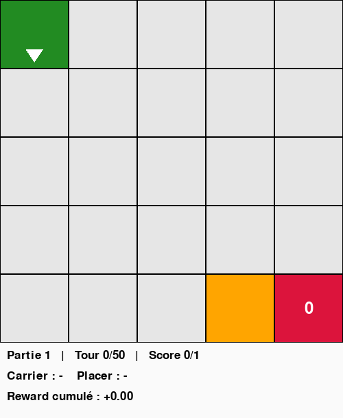
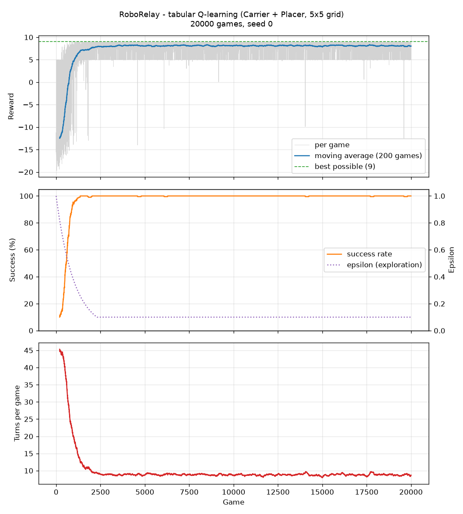

# RoboRelay

Cooperative robots trained with reinforcement learning, in a small grid world built from scratch.

Each robot has a limit that makes it useless on its own: the **Carrier** can move and carry an item but cannot store it, the **Placer** can store items but cannot move. The only way to score is to work together.



*The trained Q-learning agent: the Carrier fetches the item, drops it next to the Placer, and the Placer stores it in the same turn.*

---

## What is done

- A grid world with robots that have different abilities and limits (`env/`, `robots/`)
- A [Gymnasium](https://gymnasium.farama.org/) environment that turns the game into an RL problem, checked with Gymnasium's official `check_env`
- A **tabular Q-learning agent written from scratch** (no RL library)
- Reproducible training and evaluation (fixed seeds), learning curves, and a viewer to watch the agent play
- A keyboard version of the game, to play it yourself

> **Current scope, stated plainly:** one learner controls both robots at once (centralised control). Each robot does not yet learn on its own; true multi-agent learning is the next step (see [Roadmap](#roadmap)). The Scout robot exists in the code but is not used by the RL environment yet.

---

## The game

| Robot | Can do | Cannot do |
|---|---|---|
| **Carrier** (green) | move, pick up an item, drop it | store items |
| **Placer** (red) | store an item from a neighbour cell | move |
| **Scout** (blue) | move | *(planned: explore with a wide vision and guide the others)* |

Rules:
- One thing per cell. Robots act only on the 4 neighbour cells (no diagonals), in the direction they face.
- A game is won when the item is stored, and stopped after 50 turns.
- In the RL environment the item appears at a random empty cell each game, so the agent cannot learn one fixed path by heart.

---

## The RL problem

**Observation** (6 numbers):

| | Meaning |
|---|---|
| `carrier_x`, `carrier_y` | Carrier position |
| `target_x`, `target_y` | the item, or the Placer once the item is carried |
| `carrying` | 0 or 1 |
| `facing` | direction of the Carrier (0 up, 1 down, 2 left, 3 right) |

The target switches from the item to the Placer once the item is picked up: the observation always gives what is needed to decide *now*.

**Actions** (`MultiDiscrete([6, 2])`): each turn, one action per robot.
- Carrier: up, down, left, right (turn and move), pick up, drop
- Placer: wait, charge (stores an item from any neighbour cell)

**Rewards** (constants at the top of [`rl/gym_env.py`](rl/gym_env.py)):

| Event | Reward |
|---|---|
| Item stored by the Placer (the real goal) | +5 |
| First drop next to the Placer | +3 |
| First pick up | +1 |
| Drop somewhere useless | -0.5 |
| Placer charges with nothing next to it | -0.5 |
| Invalid pick up / drop | -0.1 |
| Every turn | -0.01 |

The two small bonuses are paid **once per game** (see [Lessons learned](#lessons-learned)). The best possible total is about 9.

**End of a game:** `terminated` when the item is stored, `truncated` when the turn limit is reached. The difference matters: after a time limit the future still exists, so the agent must not learn that "nothing more can be won" from that state.

---

## The algorithm

Tabular Q-learning ([`rl/q_learning.py`](rl/q_learning.py)): a table gives a score to each (state, action) pair, updated after every step with the Bellman rule

```
Q(s, a) <- Q(s, a) + alpha * (r + gamma * max Q(s', .) - Q(s, a))
```

- 12 actions in the table (6 Carrier actions x 2 Placer actions)
- epsilon-greedy exploration, epsilon from 1.0 down to 0.1 (x0.999 per game)
- learning rate alpha = 0.1, discount gamma = 0.95, 20,000 training games
- ties between best actions are broken at random (otherwise, in a new state, the agent always picks action 0)

---

## Results



The agent learns in about 1,500 games: success goes from 24 % (first 500 games) to 100 %, and games get shorter, from about 45 turns to about 9 (still with 10 % random actions).

**Evaluation** on 500 games the agent never trained on (seed 1000), with no random actions:

| Metric | Value |
|---|---|
| Success rate | **100 %** (500 / 500) |
| Mean turns per game | 7.60 |
| Turns compared to a lower bound of the optimum | 1.02x on average |
| Games that reach the lower bound (proven optimal) | 400 / 500 |
| Worst successful game | 1.12x |

The lower bound counts the shortest walk to the item and then next to the Placer. It ignores the extra turns sometimes needed to face the right way, so the real optimum can be a bit higher: the agent is at least as close to optimal as these numbers say.

Everything is seeded: running the commands below gives exactly these numbers.

---

## Lessons learned

The most useful part of the project was the bugs. Each one taught something about RL.

**1. Reward hacking: farming the bonuses.** The mean training reward reached about 26, while an honest game cannot give more than 9. The agent had found a loop: drop the item next to the Placer (+3), pick it up again (+1), drop it again (+3)... without ever letting the Placer store it. Ten loops gave about 40 points with zero deliveries. *Fix:* intermediate bonuses are paid once per game.

**2. The state was not Markov.** The observation did not include the Carrier's direction, but pick up and drop act in that direction. Two situations that looked identical to the agent gave different results. During training, random actions hid the problem; in evaluation with no randomness, the agent repeated the same failed action forever and won only about 11 % of games. *Fix:* add `facing` to the observation. Success went to 100 %.

**3. Robots that could be "picked up".** The Placer stored anything that was not an empty cell, including the Carrier, which disappeared from the grid while the score went up. The Carrier had the same bug and could pick up other robots. *Fix:* check for an item, not just "not empty".

**4. `terminated` vs `truncated`.** A time limit was treated as a real end of the game, so the agent learned wrong values for states that simply ran out of time. *Fix:* separate the two, and only stop bootstrapping on `terminated`.

---

## Run it

Tested with Python 3.12 (on WSL / Ubuntu).

```bash
git clone https://github.com/AlexandreGhr/roborelay.git
cd roborelay
python3 -m venv venv
source venv/bin/activate
pip install -r requirements.txt
```

```bash
python3 -m rl.train            # train (20,000 games), saves the agent in recordings/
python3 -m rl.evaluate         # measure it on 500 unseen games
python3 -m rl.plot_training    # draw the learning curves
python3 -m render.watch_agent  # watch the agent play (Space: pause, Right: one step)
python3 -m render.play         # play yourself with the keyboard
```

Options: `python3 -m rl.train --episodes 5000 --seed 1`, `python3 -m render.watch_agent --gif demo.gif`.

---

## Project structure

```
env/        the world: grid, cell types, robots placement, score, reset
robots/     robot classes (BaseRobot, MobileRobot, Scout, Carrier, Placer)
rl/         Gymnasium environment, Q-learning agent, training, evaluation, curves
render/     Pygame drawing, keyboard game, agent viewer
recordings/ learning curves and demo GIF (trained agents are generated, not stored)
```

The game rules (`env/`, `robots/`) know nothing about learning or drawing: the same world is used by the keyboard game, the RL environment and the viewer.

---

## Roadmap

Ordered from the next step to the furthest one:

1. **Unit tests** with pytest for the game rules
2. **Real multi-agent learning:** one learner per robot, each with its own observation (independent Q-learning), compared with the current centralised learner
3. **Several Carriers and several items:** robots must share the work and avoid getting in each other's way
4. **Heavy items that need two Carriers**, lifted and moved together in the same turn, worth more points. Cooperation becomes mandatory, close to the [Level-Based Foraging](https://github.com/semitable/lb-foraging) benchmark
5. **DQN in PyTorch:** with several robots the state space explodes and a table no longer fits. A neural network replaces the Q-table, compared on the same evaluation games
6. **PPO** (Stable-Baselines3) as a modern baseline
7. **The Scout and local vision:** each robot only sees nearby cells, and the Scout must explore and guide the others

---